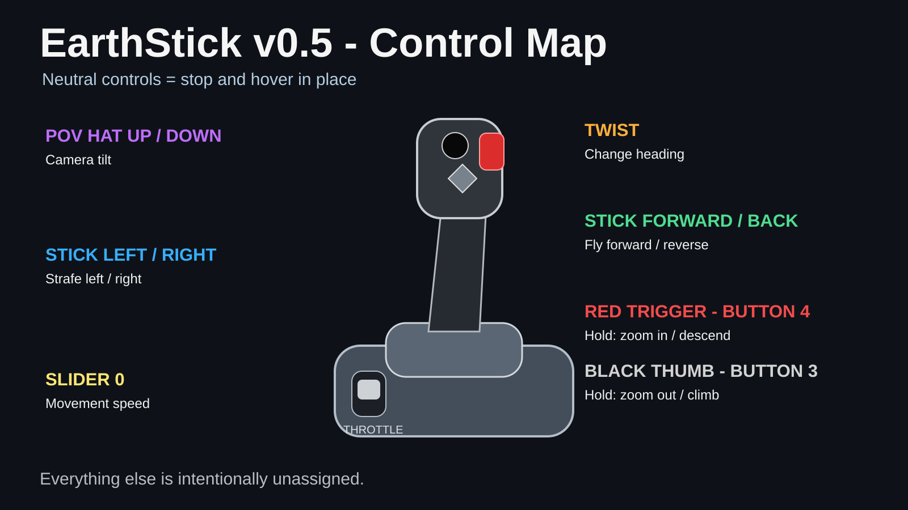

# EarthStick 1.0

**Fly the real map.**

EarthStick turns **ArcGIS Earth desktop** into a directly flyable map using a **Thrustmaster TCA Sidestick Airbus Edition**. Instead of simulating an aircraft inside a virtual world, EarthStick gives analog flight-style control to the ArcGIS Earth camera itself.

That means the environment remains a working map: satellite or aerial imagery, roads, street names, place labels, GIS layers, offline tile packages, and other ArcGIS Earth content stay available while you move through it.

> **Neutral controls = stop and hover in place.**

Push forward to travel. Pull back to reverse. Move the stick sideways to strafe. Twist to change heading. Use the throttle slider for speed, the POV hat for camera tilt, and the two top buttons to climb or descend. Release the controls and the camera stays where you left it.



## Download

**Official release:** [`EarthStick_v1.0.zip`](releases/EarthStick_v1.0.zip)

SHA-256:

`8b399d70df582c448ed2bfdf532d5dcc17f579187f99a4d165bd06ef1cb0c292`

The release contains only:

- `EarthStick.py`
- `EarthStick.bat`

No third-party Python packages are required.

## What makes EarthStick different

EarthStick is not mouse emulation and it is not keyboard remapping. It reads the joystick through Windows and sends camera position directly through the **ArcGIS Earth Automation API**.

The result is a control model built around observation rather than aircraft physics:

- **hover anywhere** by returning the controls to neutral
- **strafe sideways** without turning
- **reverse** without turning around
- **pivot heading in place**
- **climb or descend independently** of forward motion
- **change travel speed independently** with the throttle slider
- move from street-level inspection to continent-scale travel and back with the same controls
- use the same camera-control model with online maps or offline ArcGIS Earth content

A flight simulator moves an aircraft through scenery. **EarthStick moves you through the map.**

## Requirements

- **Windows 11**
- **ArcGIS Earth desktop**
- **ArcGIS Earth Automation API enabled**
- **Python 3.x** - tested with Python 3.14.5
- **Thrustmaster TCA Sidestick Airbus Edition** connected by USB
- `EarthStick.py` and `EarthStick.bat`
- Thrustmaster driver/control panel recommended

The tested controller appears in Windows as **T.A320 Pilot**. EarthStick also contains a capability-based fallback for installations where WinMM exposes the device using a generic joystick-driver name.

## Controls

| Physical control | EarthStick action |
|---|---|
| Stick forward / back | Fly forward / reverse |
| Stick left / right | Strafe left / right |
| Stick twist / RZ | Change heading |
| Slider 0 / throttle | Travel speed |
| POV hat up / down | Camera tilt |
| Red top button - Button 4 | Hold to zoom in / descend |
| Black thumb button - Button 3 | Hold to zoom out / climb |
| Neutral controls | Stop and hover in place |

Other joystick buttons are intentionally unassigned.

## Quick start

1. Install the Thrustmaster driver/control panel and connect the sidestick by USB.
2. Press `Win + R`, run `joy.cpl`, select the T.A320 controller, and verify X/Y, twist/RZ, Slider 0, POV, Button 3, and Button 4.
3. Open ArcGIS Earth.
4. Open ArcGIS Earth settings and enable **Automation API** under **Advanced**.
5. Leave the default local API address at `http://localhost:8000` unless you intentionally changed it.
6. Extract `EarthStick_v1.0.zip`.
7. Double-click `EarthStick.bat`.
8. Wait for the console to report `ArcGIS Earth: connected`.
9. Fly.

## Built-in recovery behavior

EarthStick is designed to keep a temporary hardware or ArcGIS Earth interruption from turning into a crash or a camera jump.

- If the ArcGIS Earth API disappears, EarthStick stops sending movement, waits for the API to return, then re-reads the live camera before resuming.
- If the joystick is unplugged, EarthStick remains running, waits for the controller to return, accepts a newly assigned Windows joystick ID, and re-synchronizes from the current ArcGIS Earth camera before movement resumes.
- Camera data is validated before it is accepted.
- The movement time step is bounded so a temporary stall cannot create one giant movement command.

## Technical constants

| Setting | Value |
|---|---:|
| Poll rate | 30 Hz |
| Deadzone | 0.08 |
| Heading rate | 55 deg/s |
| Tilt rate | 45 deg/s |
| Idle camera resync | 0.50 s |
| HTTP timeout | 0.75 s |
| Minimum altitude | 1 m |
| Maximum travel multiplier | 60x altitude-aware base speed |

The throttle uses a squared response curve to preserve fine low-speed control while still allowing very high travel speed at altitude.

## Architecture

```text
Thrustmaster TCA Sidestick
          |
          | Windows joystick state
          v
   WinMM / joyGetPosEx
          |
          v
      EarthStick.py
          |
          | HTTP GET/PUT camera JSON
          v
ArcGIS Earth Automation API
 http://localhost:8000
          |
          v
   ArcGIS Earth camera
```

## Documentation

- [`docs/USER_GUIDE.md`](docs/USER_GUIDE.md) - installation and operation
- [`docs/EarthStick_User_Guide.pdf`](docs/EarthStick_User_Guide.pdf) - printable user guide
- [`docs/TECHNICAL_NOTES.md`](docs/TECHNICAL_NOTES.md) - architecture, movement math, API recovery, constants
- [`docs/TROUBLESHOOTING.md`](docs/TROUBLESHOOTING.md) - failure checks and recovery
- [`docs/HARDWARE_MAP.md`](docs/HARDWARE_MAP.md) - tested controller mapping

## Safety and scope

EarthStick controls the **ArcGIS Earth map camera**. It is not an aircraft flight-control system, certified navigation system, dispatch system, or safety-of-life product. Users remain responsible for validating maps, layers, imagery, coordinates, and operational procedures.

## License

MIT License. See [`LICENSE`](LICENSE).

## References

- Esri - ArcGIS Earth Automation API overview: https://doc.arcgis.com/en/arcgis-earth/automation-api/overview.htm
- Esri - Using ArcGIS Earth Automation API: https://doc.arcgis.com/en/arcgis-earth/automation-api/use-api.htm
- Esri - Set Camera: https://doc.arcgis.com/en/arcgis-earth/automation-api/set-camera.htm
- Thrustmaster - TCA Sidestick Airbus Edition: https://www.thrustmaster.com/en-us/products/tca-sidestick-airbus-edition/
- Microsoft - `joyGetPosEx`: https://learn.microsoft.com/en-us/windows/win32/api/joystickapi/nf-joystickapi-joygetposex

## Status

**EarthStick 1.0 is the official accepted release.**
