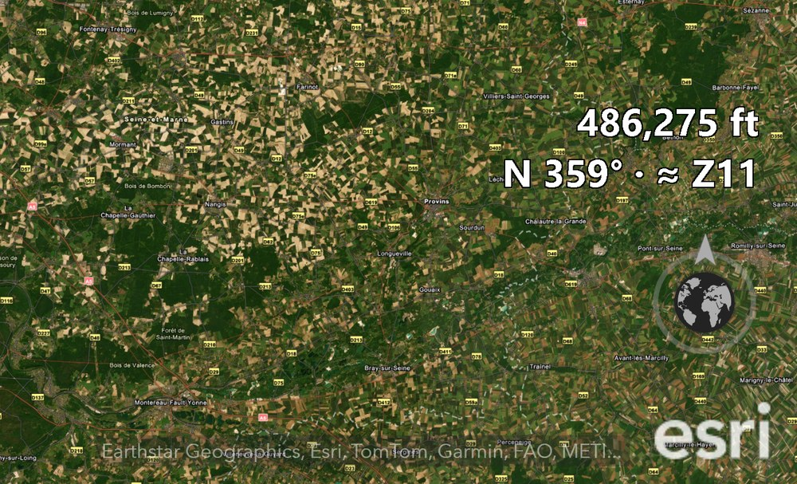

# EarthStick 1.3.3 - Changes

Released 2026-11-04. Jim's request: in full-screen mode ArcGIS Earth hides its status bar, so the eye alt disappears. Flown live as TEST, TEST2 and TEST3 the same evening; TEST3 released with "Go!".



## The readout

Two lines of white, outlined text on the right of the ArcGIS Earth window, just above the globe button:

```text
   1,970 ft
NE 45° · ≈ Z19
```

- **Height** - the camera height above sea level in feet (the same number as ArcGIS Earth's eye alt).
- **Heading** - compass point (N, NE, E, SE, S, SW, W, NW) and degrees.
- **≈ Z** - the web map zoom level that shows the ground at about the same detail from this height (useful for matching TPKX zoom levels). Worked out from the height, the latitude and the window width with ArcGIS Earth's ~78 degree view.
- Updated about four times a second from the camera EarthStick already reads while flying - no extra requests to ArcGIS Earth.
- Mouse clicks pass straight through it, like the crosshair. It follows the window and hides when ArcGIS Earth is minimized.
- Full screen: the text sits 480 px above the bottom (clear of the globe button, the esri logo and the credits - that corner belongs to ArcGIS Earth); in a normal window 695 px, to allow for the status bar.

Settings near the top of `EarthStick.py`: `SHOW_READOUT = True` (False turns it off), `READOUT_FONT`, `READOUT_COLOR`, `READOUT_RIGHT_PX = 60`, `READOUT_BOTTOM_PX = 480`, `READOUT_BOTTOM_WINDOWED_PX = 695`.

Test steps: TEST (one line, bottom corner: clipped and on the globe button) -> TEST2 (moved above the globe, room for the whole text: Jim "beautiful") -> TEST3 (altitude stacked above heading and zoom).

## Unchanged

Flying, World Gates and trigger-click: the test rigs gave the same camera commands as 1.3.2 (replay and trigger rigs identical, wormhole rig passes). Gates (`World_Gates_JAX_ATL_v19.kmz`), City Beacons and the launcher are the 1.3.2 files.

`EarthStick.py` 1.3.3 SHA-256: `36429640d3affab6e6641679797a0a3afd1d04c57c21259c416ba9b6dfab848b`

## Release file

`releases/EarthStick_v1.3.3.zip` SHA-256: `758dc8537c16ef5e789db0353422cf2661ab10edaad41ddfcb66f0719d816079`

Folder `EarthStick_v1.3.3/`: `EarthStick.py`, `EarthStick.bat`, `Fly_ArcGIS_Earth.bat`, `Make_Taskbar_Shortcut.bat`, `Gates/World_Gates_JAX_ATL_v19.kmz`, `City_Beacons/` (9 KMZ). Earlier zips stay for existing links.
