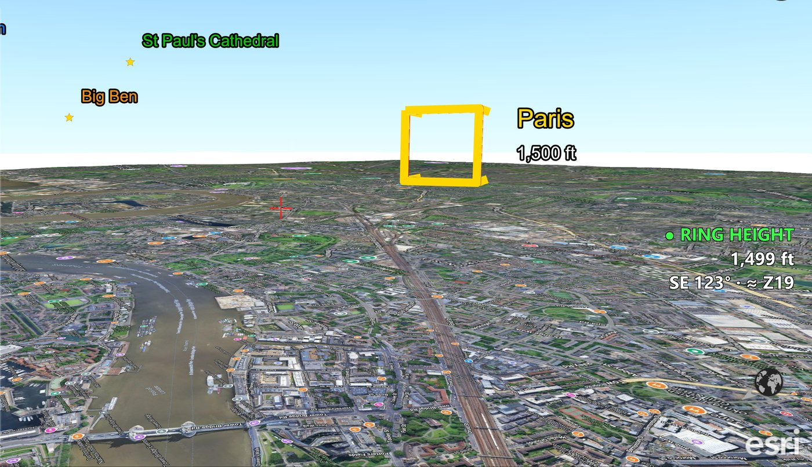
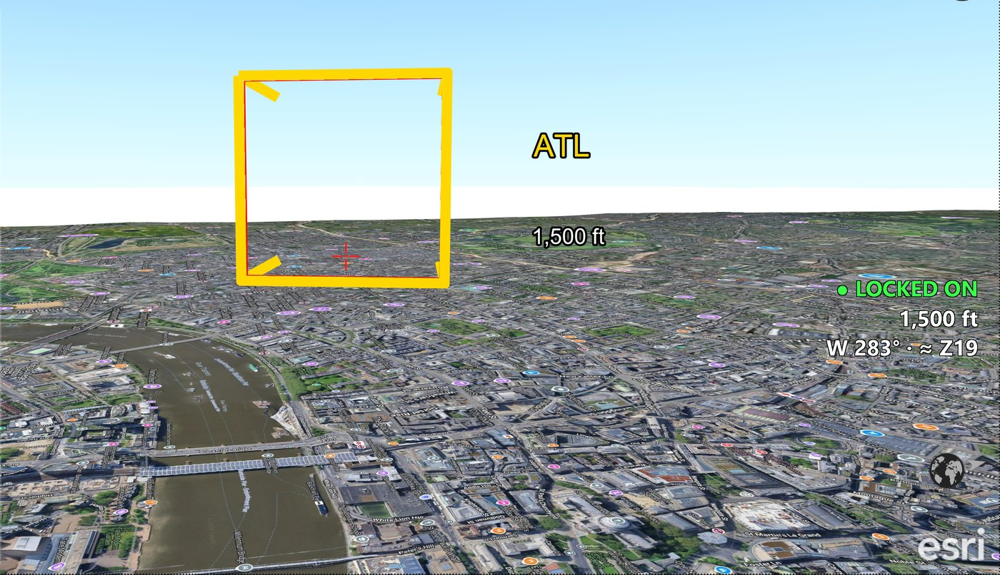

# EarthStick 1.3.4 - Changes

Released 2026-11-05. Jim's ideas, flown live the same day (TEST4 to TEST7); TEST7 accepted with "to london and back, working great".

## Why

EarthStick flies level: pushing the stick moves you straight ahead at the same height, and only buttons 3 and 4 change height. Tilting the view moves the crosshair up and down but not your path. So the crosshair already shows left and right, but it cannot show whether you are at a gate's height - the reason gates were missed.

## Square gates with legs (World Gates v21)

Jim: "the very shape of the ring is the problem ... a square gate with 90 degree legs, like a glass top side table turned sideways - the very shape would give the visual clue."

- Every gate is a **gold square** with **four legs** running 320 m straight back from its corners, in the direction you fly through it. A red square just behind marks the wrong side.
- **Lined up**, you look straight down the legs: they make an even X. **Too high, too low or off to one side**, the legs lean and show which way to move.
- The square sits inside the gate's trigger circle, so anywhere inside the square fires the gate.
- Same 22 gates, same destinations, names and heights as v19 (gate data identical). `Gates/World_Gates_JAX_ATL_v21.kmz` SHA-256 `df42e344317e1abaa7d40a9a659ab579fe1ed38e825273d708a88ba56e228d94`.

## The ring-height light

A green **● RING HEIGHT** appears above the readout when you are at the height of the gate you are flying toward (within half its radius - about ±370 ft for the World Gates).

**Ring separation (Jim):** the gate that counts is the nearest one within 15 degrees of your heading, whose gold side faces you, within 10 km - so a nearby gate off to the side or behind you never lights it. At the Atlanta hub, turn toward London and London counts; swing to Paris and Paris counts.

## The tractor beam

Jim: "a proximity snap to height ... like when a giant space ship locks on with a tractor beam to guide the last bit through."

- Within about a mile of the gate ahead and within one gate radius of its height (about ±740 ft), EarthStick glides you onto the gate's centre height. The light says **● LOCKED ON**.
- Works hovering or flying. Flying, it lays a straight glide path that ends at the mouth, so it finishes in time even at full throttle (simulated at 668 m/s: through within a foot of centre).
- **Climb or descend (buttons 3 / 4) lets go at once.** No gate in range = no effect.

Settings near the top of `EarthStick.py`: `RING_LIGHT`, `RING_LIGHT_RANGE_M = 10000`, `RING_LIGHT_CONE_DEG = 15`, `RING_LIGHT_FACING_DEG = 60`, `RING_LIGHT_TOLERANCE = 0.5`, `TRACTOR_BEAM`, `TRACTOR_RANGE_M = 1500`, `TRACTOR_CAPTURE = 1.0`, `TRACTOR_HALF_LIFE_S = 1.0`.

## Tried and set aside on the way (5 November)

- An attitude **beam/laser** on the trigger (TEST to TEST3): a beam along your line of sight is seen end-on, so from the pilot's seat it can only be a spot; ArcGIS Earth graphics are draped on the ground and drawings flash blue when redrawn. Shelved; the trigger still opens objects under the crosshair.
- **Approach arrows** on the rings (World Gates v20): they showed the gate's centre line, which you do not need to be on. Shelved.

## Unchanged

Flying, trigger-click, the readout and the wormholes: the test rigs gave the same camera commands as 1.3.3 (replay and trigger rigs identical, wormhole rig passes). City Beacons and the launcher are the 1.3.3 files.

`EarthStick.py` 1.3.4 SHA-256: `7ab8f8cd94cdf35b9be903e7b581f71604e9d95d0484d40c86afed1e850739b0`

## Release file

`archive/EarthStick_v1.3.4.zip` SHA-256: `cd600e6281bb07f7281cc1d2097e51d30646c1b605bccd8d6829afd002c2d3d2`

Folder `EarthStick_v1.3.4/`: `EarthStick.py`, `EarthStick.bat`, `Fly_ArcGIS_Earth.bat`, `Make_Taskbar_Shortcut.bat`, `Gates/World_Gates_JAX_ATL_v21.kmz`, `City_Beacons/` (9 KMZ). Earlier zips stay for existing links.
