# EarthStick 1.3.9 User Guide

A printable copy of this guide is available as [EarthStick_User_Guide.pdf](EarthStick_User_Guide.pdf).

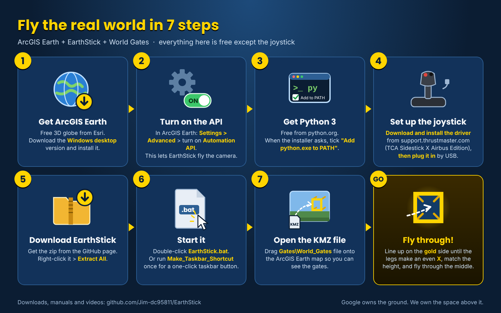

*The whole setup on one page.*

## Purpose

EarthStick gives a Thrustmaster TCA Sidestick Airbus Edition direct control of the ArcGIS Earth camera. The goal is free movement inside a functioning map: imagery, labels, roads, GIS layers, and offline content remain part of the environment while you fly the camera.

The defining behavior is **neutral = hover**. When the movement controls return to neutral, EarthStick stops moving the camera.

New in 1.3.9: **Ready to Fly** - `Fly_ArcGIS_Earth.bat` gets the PC ready first: it installs Python for you if it is missing, starts ArcGIS Earth and checks its Automation API is on (see *Start EarthStick* below). New in 1.3.6: the **Gate Dropper** - press Button 2 at two places and a pair of gates appears there (see *Drop gates as you fly* below). New in 1.3.5: a tidy folder - just `Fly_ArcGIS_Earth.bat` to double-click, with the program tucked into `System Files`. New in 1.3.4: **square gates** that show you how to line up, a green **ring-height light**, and a **tractor beam** that guides you through (see *Lining up a gate* below).

New in 1.3.3: your **height, heading and map zoom** on screen, even in full-screen mode (see *The readout* below).

New in 1.3.2: the World Gates pack v19 - each city's welcome sign and site stars float up in the sky, far away, where they stay clear of the gates.

New in 1.3.1: a **round-the-world tour** through the World Gates, with welcome signs and one-click site beacons in every city; a larger crosshair; and a **one-click start** from the taskbar (see *One-click start* below).

New in 1.3: **World Gates** - golden rings in the sky; fly through one and you arrive somewhere else on Earth (see *World Gates* below).

New in 1.2: **trigger-click**. A red crosshair sits in the middle of the ArcGIS Earth window. Put an object under it and pull the trigger to open the object's information box (popup) without touching the mouse.

## Requirements

- Windows 11
- ArcGIS Earth desktop
- ArcGIS Earth Automation API enabled
- Python 3 (since 1.3.9 `Fly_ArcGIS_Earth.bat` installs it for you if it is missing; or get it from python.org); tested with Python 3.14.5 (the standard install includes Tkinter, which draws the crosshair)
- Thrustmaster TCA Sidestick Airbus Edition connected by USB
- Thrustmaster driver/control panel recommended
- the EarthStick folder as it comes out of the zip (`Fly_ArcGIS_Earth.bat` next to `System Files`)

No third-party Python packages are required.

## Controller check

First [download and install the Thrustmaster driver](https://support.thrustmaster.com/en/product/tca-sidestick-x-airbus-ed-en/#drivers) (TCA Sidestick X Airbus Edition), then plug the joystick in by USB.

Before running EarthStick:

1. Press `Win + R`.
2. Run `joy.cpl`.
3. Select the T.A320 controller.
4. Confirm the stick X/Y axes move and return to center.
5. Confirm twist/rudder responds.
6. Confirm Slider 0 travels through its range.
7. Confirm POV up/down responds.
8. Confirm Button 4, Button 3 and the trigger (Button 1) respond.

The tested controller normally appears as `T.A320 Pilot`.

## ArcGIS Earth setup

1. Open ArcGIS Earth desktop.
2. Open Settings.
3. Under Advanced, enable **Automation API**.
4. Use the default local API address `http://localhost:8000`.

## Start EarthStick

1. Download [`EarthStick_v1.3.9.zip`](../releases/EarthStick_v1.3.9.zip) and extract it. It contains a folder named `EarthStick_v1.3.9` holding `Fly_ArcGIS_Earth.bat` (the one to double-click), a `Gates` folder with the World Gates pack, a `City_Beacons` folder and `System Files` (the program - leave it alone).
2. Make sure ArcGIS Earth's Automation API is enabled (above).
3. Open the `EarthStick_v1.3.9` folder and double-click `Fly_ArcGIS_Earth.bat`. A window titled **Ready to Fly** gets the PC ready, with a green **OK** for each check:
   - **Internet** - if you are offline it says so (online basemaps won't load; your offline TPKX maps still work) and carries on.
   - **Python** - if it is missing it asks **Install Python now? [Y/N]**. Type **Y** and press Enter: it installs Python just for you (no admin). On an older PC this can take several minutes and Windows Defender may make the PC look frozen - that is normal, **do not close the window**.
   - **ArcGIS Earth** - found and started if it is not open yet. Not installed? It offers to open Esri's free download page.
   - **Automation API** - if ArcGIS Earth is open but not answering, it tells you: **Settings > Advanced application settings > tick Enable Automation API**, then press Enter.

   Then the same window becomes **EarthStick 1.3.9**. If something stops it, the message says what to do, and a log is kept in `System Files\Ready_To_Fly_log.txt`. Double-clicking again while EarthStick is running just tells you it is already running.
4. EarthStick reports the detected joystick and Slider 0 source. If the joystick is not plugged in, it says so and waits until it is.
5. It then shows `Waiting for ArcGIS Earth Automation API at http://localhost:8000 ...`. If ArcGIS Earth is not ready, `Still waiting:` lines explain why.
6. Wait for `ArcGIS Earth: connected`, followed by `Trigger-click: ready`. The red crosshair appears in the middle of the ArcGIS Earth window.
7. Return the stick to neutral before beginning.

### What each file in the folder does

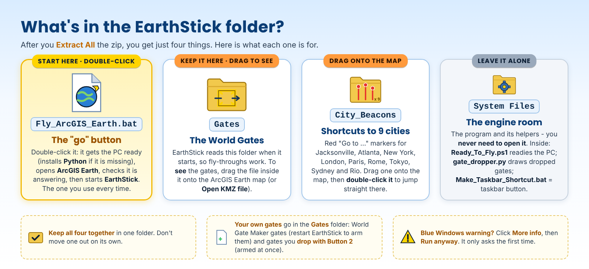

## Controls

| Control | Action |
|---|---|
| Stick forward | Fly forward |
| Stick back | Reverse |
| Stick left/right | Strafe left/right |
| Twist/RZ | Change heading |
| Slider 0 | Travel speed |
| POV up/down | Camera tilt |
| Red Button 4 | Hold to descend / zoom in |
| Black Button 3 | Hold to climb / zoom out |
| Trigger (Button 1) | Click the object under the red crosshair |
| Button 2 (press) | Gate Dropper: mark a place (two marks = a gate pair) |
| Button 2 (hold 2 s) | Undo the last gate drop |
| Neutral | Stop and hover |

## Flying technique

For precise inspection, lower the throttle, approach the target, release the stick, and hover. Use strafe and twist independently to inspect the target from different positions without being forced into forward motion.

For long-distance movement, climb to a high altitude and increase the throttle. The maximum travel rate scales with altitude. Descend again when you reach the destination.

## The readout: height, heading and zoom (1.3.3)

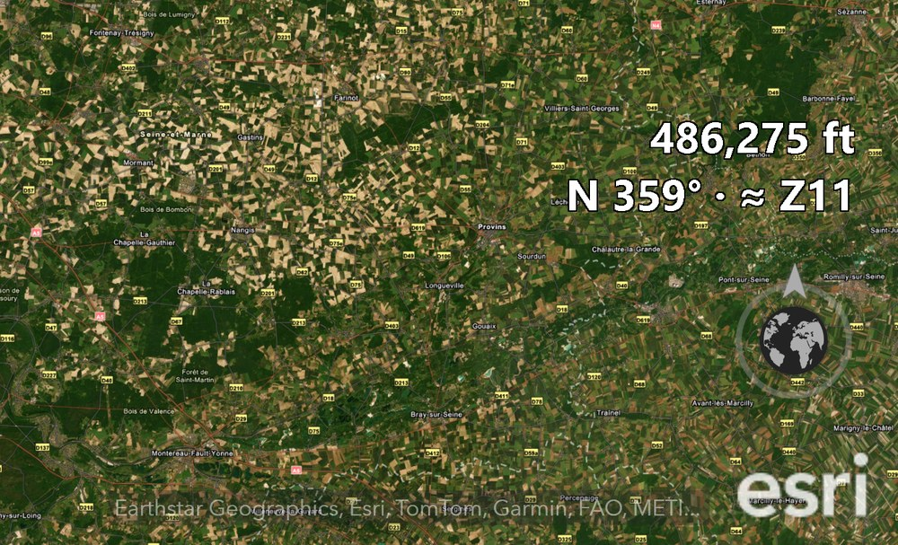

On the right of the ArcGIS Earth window, just above the globe button, EarthStick shows two lines while you fly:

- **Top line - height** in feet above sea level (the same number as ArcGIS Earth's eye alt, which disappears in full-screen mode).
- **Bottom line - heading and zoom:** the compass point and degrees you are facing, then **≈ Z** and the web map zoom level that shows the ground at about the same detail from your height. Handy for knowing when your TPKX maps (for example Z17 or Z20) are at their sharpest.

The readout lets mouse clicks pass through, follows the window, and hides while ArcGIS Earth is minimized. To turn it off, open `EarthStick.py` in Notepad and change `SHOW_READOUT = True` to `SHOW_READOUT = False`.

## Trigger-click: opening and closing information boxes

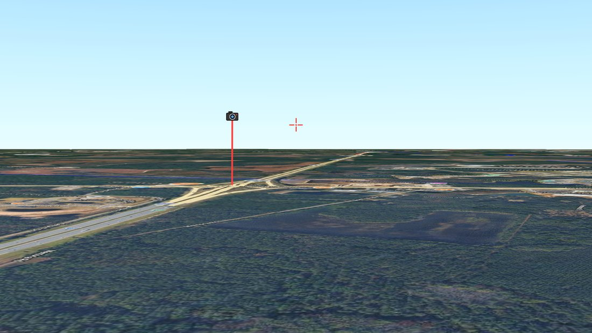

*The red crosshair (right) and a camera object (left). Fly until the camera sits under the crosshair, hover, then pull the trigger.*

1. Fly until the object (a beacon, a camera, a parcel, a point) sits under the red crosshair.
2. Let go of the stick so the camera hovers.
3. Pull the trigger once. EarthStick moves the Windows mouse pointer onto the object, clicks it, and puts the pointer back where it was. The object's information box opens.
4. **To close the box,** aim the crosshair at open map, away from the box, and pull the trigger again.

Tips:

- One pull = one click. A second pull within 0.8 seconds is ignored, so a bouncy trigger can never turn into a double-click (a double-click makes ArcGIS Earth zoom in).
- If another window is in front, the first click brings ArcGIS Earth to the front and EarthStick then clicks the object.
- The crosshair follows the ArcGIS Earth window if you move or resize it, and hides while ArcGIS Earth is minimized. Mouse clicks pass straight through it.
- If the crosshair cannot be shown, the console says `Trigger-click: unavailable` and EarthStick flies normally.
- If the crosshair sits off the true centre on your screen, the `CENTER_OFFSET_X` / `CENTER_OFFSET_Y` settings near the top of `EarthStick.py` nudge it by screen pixels.

## World Gates: flying through wormholes

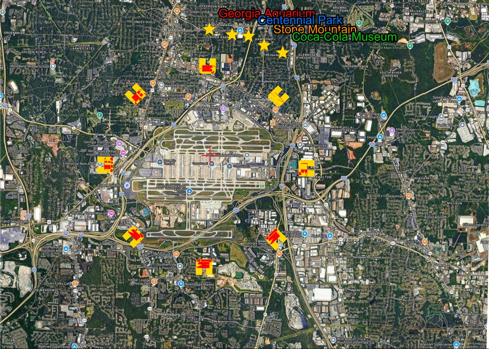

*The Atlanta hub from 49,500 ft: eight gates in a circle around Hartsfield-Jackson. Each gate's legs point the way you fly through it, so from above the picture is a map of where each one sends you.*

A gate is a gold square (with legs) floating in the sky. Fly through it and EarthStick moves you to its destination in an instant. You arrive still flying, facing the landmark.

### Fly your first trip

1. Open the **World Gates** file in ArcGIS Earth: drag `Gates\World_Gates_JAX_ATL_v21.kmz` (in the EarthStick folder) onto the map, so you can see the gates.
2. Start EarthStick. The console lists the gates it armed: `Wormholes: 22 gate(s) armed: ATL, JAX, NYC, ...`
3. Fly to a gate, put it under the crosshair with its **gold** side toward you (from the red side nothing happens), and fly through the middle. The legs, the green light and the tractor beam help you line up - see *Lining up a gate* below.
4. The view jumps to the destination and the console says `Wormhole: through the ... gate.` You arrive still flying, already facing the landmark.

### Lining up a gate (1.3.4)

EarthStick flies level: pushing the stick moves you straight ahead at the same height, and only buttons 3 and 4 change height. So **left and right** is easy - you go exactly where the crosshair points sideways - but **height** is easy to miss, because tilting the view moves the crosshair without moving you. Three things help:

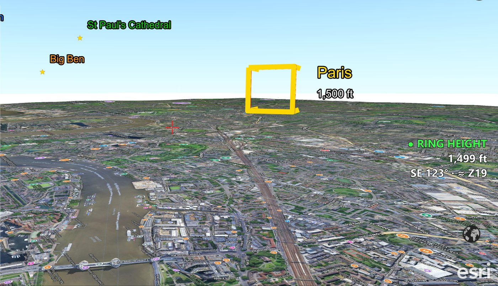

*Just arrived in London: the Paris gate ahead, and the green light already on - 1,499 ft for a 1,500 ft gate.*

- **The legs.** Each gate is a gold square with four legs running back the way you fly through it. Lined up, you look straight down the legs and they make an even **X**. Too high, too low or off to one side, the legs lean toward where you need to go.
- **The green light.** **● RING HEIGHT** comes on above the readout when you are within half a gate's size of its centre height (about ±370 ft for the World Gates). It only counts the gate you are flying toward - the nearest one within 15 degrees of your heading, gold side facing you - so a gate off to the side never lights it.
- **The tractor beam.** Within about a mile of that gate and within about 740 ft of its height, EarthStick takes over the height and glides you onto the centre: the light says **● LOCKED ON**. It works hovering or flying, even at full throttle. Press climb or descend (buttons 3 / 4) and it lets go at once.

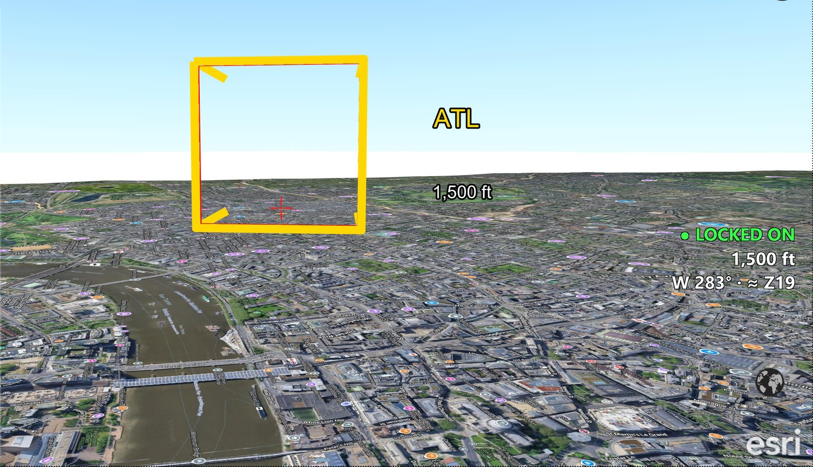

*Heading home: the tractor beam has locked on to the ATL gate at exactly 1,500 ft.*

So: put the gate under the crosshair, let the light and the beam handle the height, push forward, and you are through.

### The World Gates pack (included)

- **Jacksonville:** one gate, **ATL**, over Jacksonville International (eye alt 1,500 ft), facing north-west toward Atlanta.
- **Atlanta hub:** you arrive in the middle of a 3 km circle of eight gates around Hartsfield-Jackson, all at eye alt 2,530 ft (1,500 ft above the airport). Turn and pick: NYC (north-west), London (north), Paris (north-east), Rome (east), JAX - home (south-east), Rio (south), Sydney (south-west), Tokyo (west).
- **Destinations:** you arrive about 1.7 km from the Statue of Liberty, Tower Bridge, the Eiffel Tower, the Colosseum, Tokyo Tower, the Sydney Opera House or Christ the Redeemer, facing it. The **ATL** gate behind you takes you back to the hub to connect home or onward.
- **Round-the-world tour (1.3.1):** about 2 km beyond each landmark is a gate to the next city: New York > London > Paris > Rome > Tokyo > Sydney > Rio, and Rio's onward gate is its ATL gate. Fly in, pass the landmark, and carry on through the next gate.

### Welcome signs and site beacons (1.3.1)

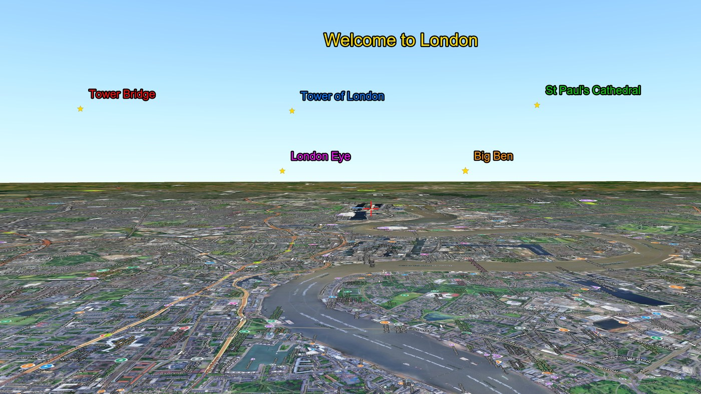

*Coming out of a gate in London.*

- **Welcome sign:** "Welcome to ..." floats ahead of you, up in the sky about 6 km away (at Atlanta, above the ring of gates).
- **Site stars:** below it, five gold stars in two rows (about 4 km away, still in the sky) name the city's famous sites (Atlanta and Jacksonville too). Each name is drawn in its beacon's colour: red, blue, green, magenta, orange.
- **Beacon on:** aim the crosshair at a star and pull the trigger. A short information box opens and a beacon in that colour shoots up over the site (3 km tall), with its name at the bottom. Pull the trigger on open map to close the box, then fly to the beacon. Clicking the same star again does not add a second beacon.
- **Beacon off:** untick it under **My Drawings** on the left of ArcGIS Earth.
- Signs, stars and gate names only show within about 4 miles, so far-away views stay clean. Beacons use ArcGIS Earth's Automation API, the same setting EarthStick needs.

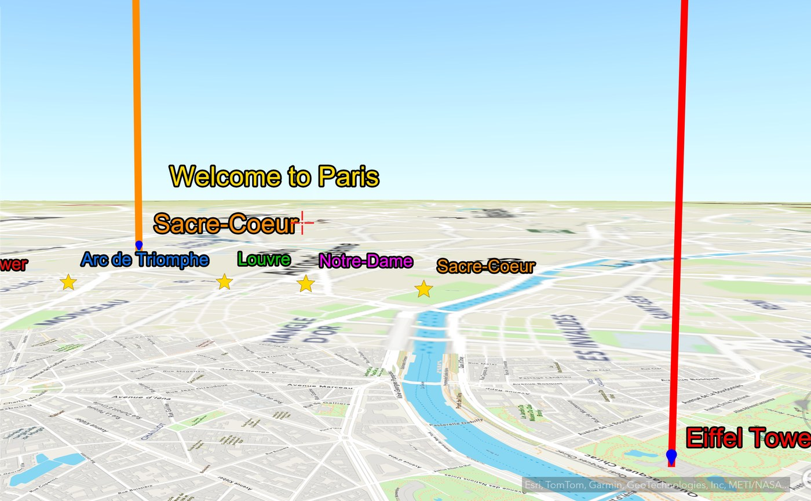

*Two beacons up in Paris.*

### City beacons: straight to a city (1.3.1)

The `City_Beacons` folder holds nine red beacons (Go to Jacksonville, Go to Atlanta, Go to New York ... Go to Rio de Janeiro). Drag them onto ArcGIS Earth. Double-click one in the Data list and ArcGIS Earth flies you there, skipping the gates. You arrive straight above the beacon, so nudge the view to see its line.

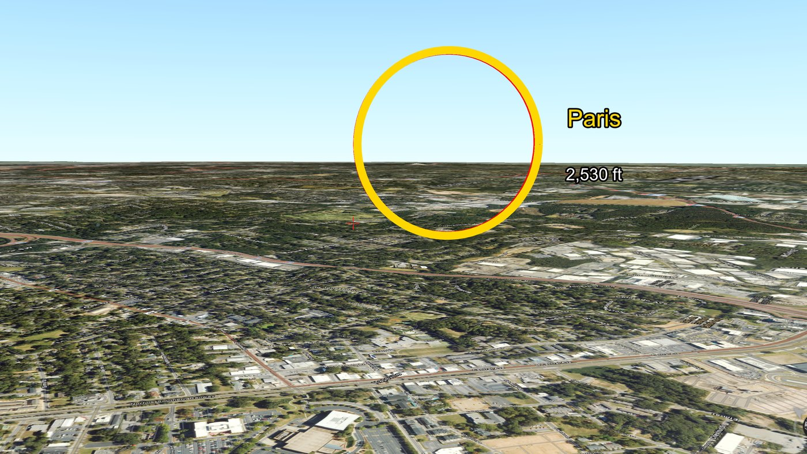

*Before 1.3.4 the gates were round rings. Then as now, each gate's name sits beside it, with the eye alt to fly at underneath.*

### Rules of the gates

- **Gold side only.** Each gate has a gold front and a red back. Fly in from the gold side; from the red side, from below, from above or beside it, nothing happens.
- **Match the altitude.** The number under each name is the **eye alt** (shown at the bottom of ArcGIS Earth, measured from sea level) of the gate's centre. The square is about 320 m (1,040 ft) across; the green light and the tractor beam (above) take care of the height for you.
- **Keep moving.** A gate fires while the joystick is moving the camera. Hovering or moving the map with the mouse does not trigger it.
- **One trip per pass.** After a jump, gates rest for 2 seconds.
- **Any speed works.** EarthStick checks the whole path between its updates, so even a fast pass cannot skip through a gate.

### Turning gates on and off

EarthStick reads the gate files in the **Gates** folder beside `EarthStick.py` **when it starts**. ArcGIS Earth cannot tell EarthStick which layers are switched on, so the folder is the switch:

- **On:** put a gate file (`.kmz`) in the Gates folder, open the same file in ArcGIS Earth so you can see the gates, and restart EarthStick.
- **Off:** move the file out of the Gates folder and restart EarthStick. With an empty or missing Gates folder, EarthStick simply flies with no gates.
- After adding or removing a gate file, always **restart EarthStick** - it only reads the folder at startup. (Gates you drop with Button 2 are the exception: they are armed and removed at once - see *Drop gates as you fly*.)

Several gate files can be used at once. A gate's partner is looked up in its own file first, so two files may reuse names such as ATL or JAX.

## One-click start (1.3.1)

Start ArcGIS Earth and EarthStick with one click from the taskbar.

1. In the EarthStick folder, open **System Files** and double-click `Make_Taskbar_Shortcut.bat` once. It looks for ArcGIS Earth (the first time can take a minute), remembers where it is in `System Files\ArcGIS_Earth_path.txt`, and puts an **ArcGIS Earth Flight** shortcut with the ArcGIS Earth icon on your desktop.
2. Right-click the shortcut > **Show more options** > **Pin to taskbar**. You can then delete the desktop copy.

Clicking it starts ArcGIS Earth (unless it is already open), then EarthStick. EarthStick waits until ArcGIS Earth is ready, so the order takes care of itself. Double-clicking `Fly_ArcGIS_Earth.bat` does the same.

If it says it cannot find ArcGIS Earth: right-click your normal ArcGIS Earth shortcut > **Properties**, copy the **Target** (it ends in `.exe`), paste it as the only line of a text file named `ArcGIS_Earth_path.txt` in the EarthStick folder's **System Files**, and run it again.

### Drop gates as you fly (1.3.6)

The **Gate Dropper** makes a pair of gates right where you fly - no coordinates, no typing, no restart.

1. Fly to the first place. **Face the way you want to fly** and come down to the height you want the gate at (down in the detail, not high above it). Press **Button 2**. The light above the readout says **MARK 1 SAVED** with your height.
2. Fly to the second place (at least about 1.1 km away - another painting, another city, home). Face your way and press **Button 2** again: **GATES DROPPED · Dropped_Gate_01**.
3. Each gate now stands **500 m in front of where you pressed**, at your height, open side toward you. **Push forward** and fly through. You come out 300 m past the other gate, looking the way you looked when you marked it - the gate behind you, so you never bounce straight back.

The gates are armed at once, and EarthStick also puts the file on the ArcGIS Earth map for you (it appears in the Data list as *Dropped Gate 01*). The file is saved in the **Gates** folder (`Dropped_Gate_01.kmz`, then 02, 03 ...), so the gates are still there next time.

**Undo:** **hold Button 2 for 2 seconds.** If you have only marked one place, the mark is cleared (**MARK 1 CLEARED**). Otherwise the last pair you dropped is removed: the file is deleted, the gates are disarmed and the layer leaves the map (**UNDONE · Dropped_Gate_01**). Hold again to undo the pair before that. The number is reused. (If EarthStick was restarted since the drop, untick or remove the old layer in ArcGIS Earth yourself.)

**How dropped gates look and grab you:** thin **black** lines with a red back and white names, with a big opening (about 425 m / 1,390 ft across), so they stay quiet over a painting. Their tractor beam reaches much further than other gates: from **3 km** out and up to **2,000 ft above or below**, with a countdown in the light - **LOCKED ON · 560 ft**. At the gate's height you are usually looking down at the picture, so the gate itself is above your view: push forward and trust the countdown, or tilt up with the hat to see it. Tap Button 3 or 4 to break free.

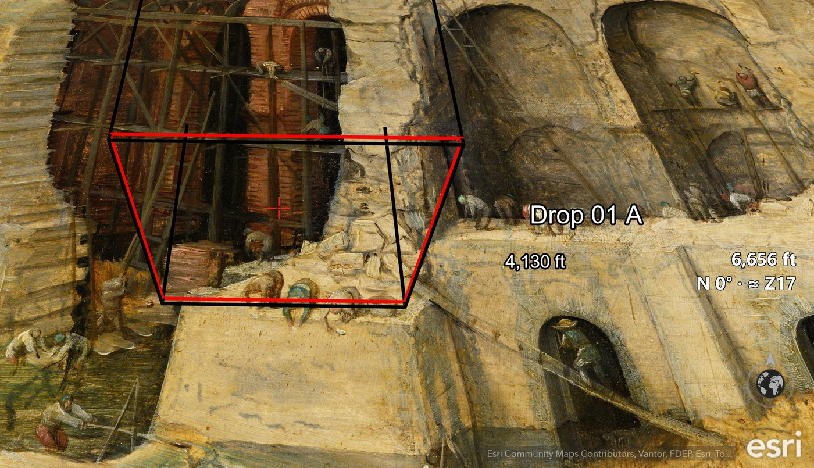

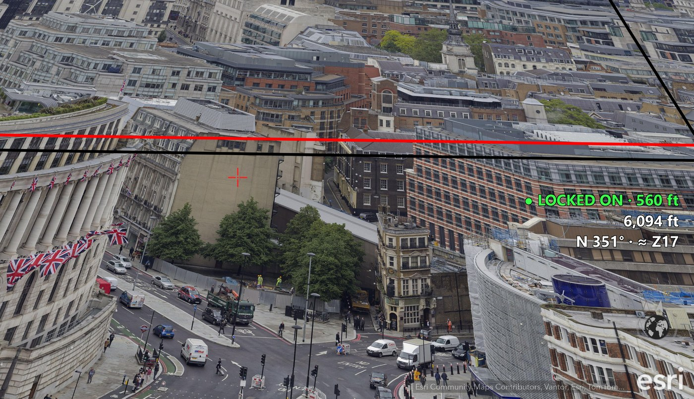

**Art tours:** with [Picture World Maker](https://github.com/Jim-dc95811/Picture-World-Maker), put each painting on its own World spot, then drop a pair from each painting to the next - an artist's paintings one after another, joined by gates.

### Making your own gates

Gate files are ordinary KMZ files with the gate drawn in gold and the gate details stored inside. The easy way to make your own pair between any two places is **World Gate Maker** ([download and manual](../README.md#make-your-own-gates)): type two places, press MAKE GATES, and the file lands in your Gates folder. For advanced users, the `make_gate_kmz.py` script in the [ArcGIS Earth Unlocked toolbox](https://github.com/Jim-dc95811/ArcGIS-Earth-Unlocked/tree/main/tools) can also make one-way gates that lead to a fixed spot with no way back (a "trap door" - fly home the long way).

## Using the mouse while EarthStick is running

When the joystick is idle, EarthStick periodically re-reads the ArcGIS Earth camera. You can reposition the map with normal ArcGIS Earth controls, then return to the joystick. Since 1.3.9 this also holds while the tractor beam is nudging you toward a gate: it changes only your height and never pulls back what you did with the mouse. When movement begins, EarthStick synchronizes from the current camera state.

## Automatic recovery

### ArcGIS Earth API interruption

If the Automation API disappears, EarthStick stops writing camera movement and waits. It does not keep advancing a hidden local camera. When the API returns, EarthStick reads the live camera again before flight resumes.

### Joystick disconnect

If the sidestick is unplugged, EarthStick remains running and waits for it to return. Reconnect the joystick. EarthStick re-detects it, even if Windows assigns a different joystick ID, then reads the live ArcGIS Earth camera before movement resumes.

## Stop EarthStick

Press `Ctrl+C` in the EarthStick console or close the console window. After `Ctrl+C` the console shows `Stopped.` and waits for a key press before closing.

## Self-test

From a command prompt in the EarthStick folder:

```text
py -3 EarthStick.py --selftest
```

(If the `py` launcher is not installed, use `python` instead of `py -3`.) The self-test needs no joystick and no ArcGIS Earth.

A successful run prints:

```text
EarthStick self-test PASS
```

## Important scope note

EarthStick moves the ArcGIS Earth **map camera**. It is not an aircraft controller or certified navigation system. Always validate the underlying map, imagery, GIS layers, coordinates, and offline packages for the intended use.
