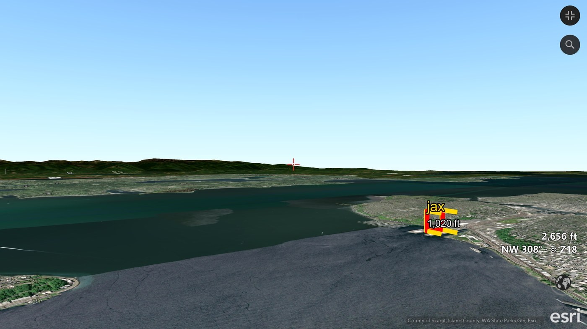
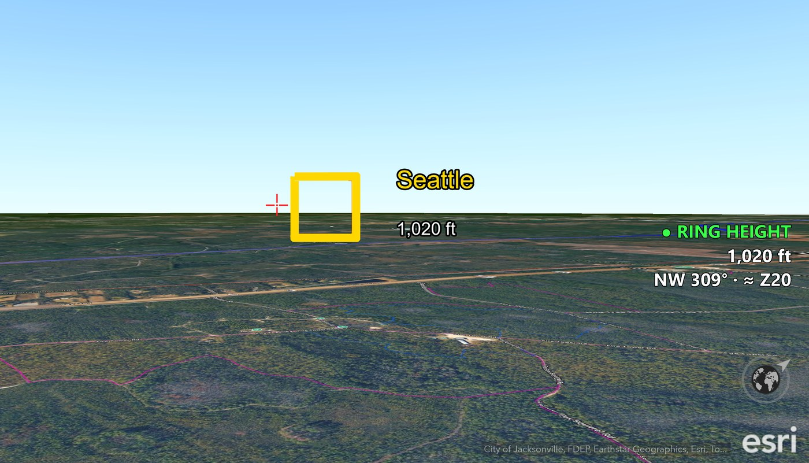
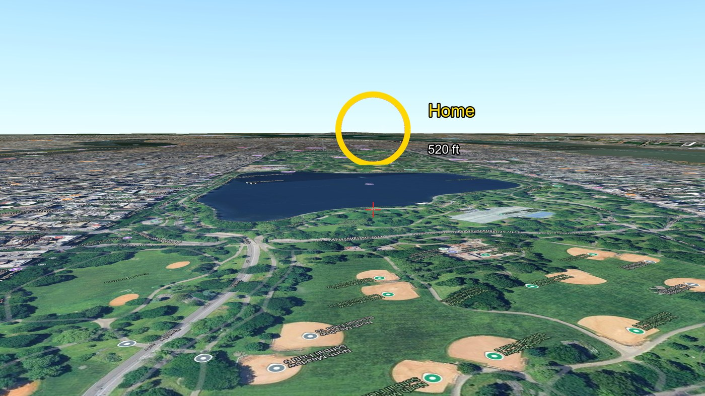
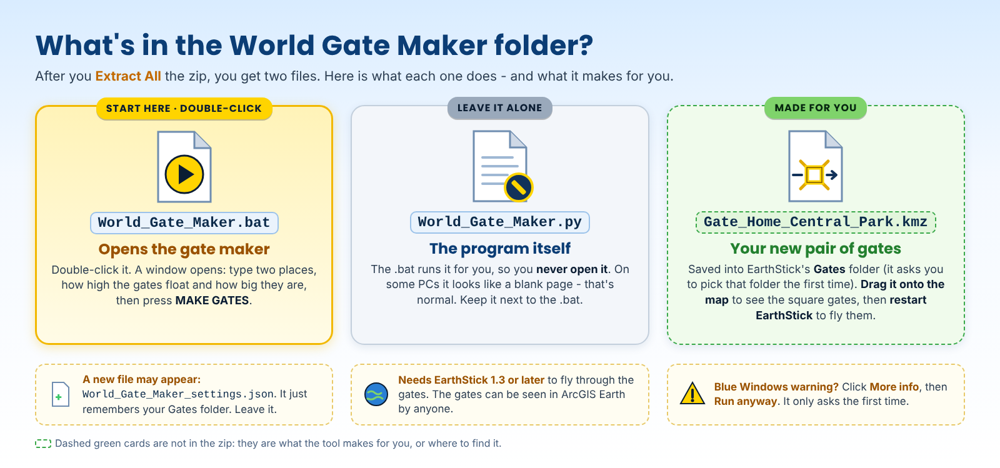

# World Gate Maker 1.1 - User Manual

Printable copy: [World_Gate_Maker_User_Manual.pdf](World_Gate_Maker_User_Manual.pdf)

Make your own **World Gates**: pick two places, and World Gate Maker builds a pair of golden gates. Fly through the gate at one place with EarthStick and you come out at the other; the gate there brings you back.

**New in 1.1:** the gates are **squares with four legs** running back from the corners - the same look as the World Gates pack in EarthStick 1.3.4. One glance shows where the way in is and which way the gate points.



*Jacksonville to Seattle with World Gate Maker 1.1: just arrived in Seattle, with the "jax" gate home seen from the side - the legs show the way in at a glance.*



*Safe return home: lined up on the "Seattle" gate in Jacksonville, at the gate's height (1,020 ft) - EarthStick 1.3.4's green **RING HEIGHT** light is on.*



*Made with World Gate Maker 1.0 (when gates were rings): a "Home" gate over Central Park, partnered with a "Central Park" gate near home in Jacksonville.*

## What you need

- **EarthStick 1.3 or later** with its **Gates** folder ([EarthStick page](../README.md)).
- **ArcGIS Earth** desktop with the Automation API on (as for EarthStick).
- **Python 3** (as for EarthStick). World Gate Maker uses only the standard library: nothing to install.

## Start

1. Download [`World_Gate_Maker_v1.1.zip`](../releases/World_Gate_Maker_v1.1.zip), right-click it > **Extract All**.
2. Open the `World_Gate_Maker_v1.1` folder and double-click `World_Gate_Maker.bat`.

## What's in the zip



## Make a pair of gates

For **Place 1** and **Place 2**:

1. **Name** - what the place is called, for example `Home`, `Station 7`, `Central Park`. Keep names short (18 characters or fewer) so ArcGIS Earth shows them on one line.
2. **Latitude / Longitude** - type them, or use Google Maps: right-click the spot, click the numbers at the top of the menu to copy them, then press **From Clipboard**. The line underneath shows how they were read - check it.
3. **Ground elev (ft)** - in ArcGIS Earth, put the mouse pointer on the spot and read **elev** in the status bar at the bottom. Type that number.

Then:

4. **Height above ground (ft)** - how high the middle of each gate floats above the ground (default 500 ft).
5. **Gate size** - the width of the square: Small (70 m), Medium (180 m, the default) or Large (320 m, the size of the World Gates pack). The legs grow with it: 71 m, 178 m and 320 m.
6. Press **MAKE GATES**. The first time, choose the **Gates** folder inside your EarthStick folder; World Gate Maker remembers it.

It saves `Gate_<Place 1>_<Place 2>.kmz` and shows the eye alt to fly at for each gate.

## Fly them

1. Drag the new `.kmz` from the Gates folder onto ArcGIS Earth so you can see the gates.
2. **Restart EarthStick** - it reads the Gates folder when it starts. The console lists the new gates.
3. Fly to a gate, line up on its **gold** side, match the **eye alt** shown under its name, and fly through the middle. Lined up straight, the four legs make an even X; if they lean, you are off to that side or too high or low.
4. With **EarthStick 1.3.4 or later**, a green **RING HEIGHT** light comes on when you are at the gate's height, and on the last 1,500 m the tractor beam pulls you onto it (**LOCKED ON**). The beam grabs you when you are within the gate's grab zone above or below its middle: Small ±164 ft, Medium ±410 ft, Large ±738 ft. Higher or lower than that, it lets you fly past. Hold Button 3 or 4 to break free.

## How the gates are set up

- Each gate is **named for where it takes you**: the gate at Place 1 carries Place 2's name, and the gate at Place 2 carries Place 1's name.
- Each gate **faces the other place**, so you fly toward home to go home.
- **Gold front, red back** - from the red side nothing happens. The legs point out the back (the way you leave).
- You arrive **300 m in front of the other gate**, heading away from it, so you never bounce straight back.
- Names and eye alt numbers show only when you are near (within about 4 miles), so far-away views stay clean.

## Messages

- **"The two places need different names"** - each gate is named for its destination, so the names must differ.
- **"Height above ground must be at least ... ft"** - the bottom of the gate would touch the ground. Raise the height or pick a smaller gate.
- **"The places are only ... m apart"** - the places are too close for that gate size.
- **"... is long"** - a name over 18 characters may split onto two lines in ArcGIS Earth. Shorten it if it does.
- **"... is not named 'Gates'"** - EarthStick only reads the Gates folder beside `EarthStick.py`. Choose that folder.

## Turning gates off

Move the `.kmz` out of the Gates folder (and remove it from ArcGIS Earth), then restart EarthStick.

## Self-test

```text
py -3 World_Gate_Maker.py --selftest
```

Checks coordinate reading, gate names and directions, heights, the safety limits, the square and its legs, and the saved file.
